# PROJECTDOC.md — Maintenance Ticket Prioritization Agent

**Project Name:** AI Agent for Maintenance Ticket Prioritization (Greenko Renewable-Energy Assets)  
**Presenter:** Nagavamshi Yamjala (Vamshi)  
**Date:** 2026-11-12  
**Repo Status at Start:** **Starter** — `backend/app.py` was a 28-line placeholder (`/api/run` returned `"Implement candidate solution here."`), `frontend/index.html` was a 10-line stub calling `/api/demo`, and `data/maintenance_tickets.csv` contained 6 sample rows. Everything beyond the starter was built from scratch in this session.  
**Tech Stack:** Python 3.12.3, FastAPI 0.115.0, Uvicorn 0.30.6, scikit-learn 1.5.1, pandas 2.2.2, NumPy 1.26.4, joblib 1.6.0, Pydantic 2.8.2, pytest 9.2.0, plain HTML/CSS/JS, Railway (`Procfile`).  
**One-Line Summary:** An offline-capable, safety-first hybrid NLP + rule/tool-based triage agent that classifies renewable-energy maintenance tickets, escalates hazards deterministically, retrieves runbook actions, and routes tickets with full reasoning traces.

---

## Section 1: 60-Second Pitch (Spoken Script)

> "Renewable-energy operators like Greenko receive hundreds of maintenance tickets across solar, wind, hydro, and grid assets every week. If a critical fault—like wind turbine gearbox vibration or an overheating inverter—is triaged late or sent to the wrong team, it causes generation loss, equipment damage, and safety or compliance risks.
>
> I built a Maintenance Ticket Prioritization Agent for control-room O&M analysts. Given a free-text ticket and asset type, the system cleans the text, extracts equipment IDs, predicts the fault category and severity using a TF-IDF and Logistic Regression pipeline, and then runs a deterministic safety guardrail that can escalate—never downgrade—hazardous tickets. It retrieves probable root causes and next actions from a local O&M runbook, computes a transparent priority score, routes the ticket to the right team with an SLA, and flags low-confidence cases for human review—all with a step-by-step agent trace.
>
> It runs 100% offline with no API key required, and has an optional LLM explanation layer off by default. Its main honest limitation is that the bundled dataset has only 6 rows, so I trained on a seeded synthetic dataset and tested generalisation on a separate hand-written challenge set; before production, it needs real historical tickets from a CMMS."

---

## Section 2: Solution Flow Diagram

```mermaid
flowchart LR
    A["Ticket Text + Asset Type"] --> B["1. normalize_and_extract\n(clean text, regex IDs)"]
    B --> C["2. classify_ticket\n(TF-IDF + LogReg:\ncategory, severity, confidence)"]
    C --> D["3. safety_guardrail\n(escalate-only hazard rules)"]
    D --> E["4. lookup_runbook\n(TF-IDF cosine retrieval)"]
    E --> F["5. check_duplicates\n(recent ticket similarity)"]
    F --> G["6. compute_priority\n(transparent weighted score)"]
    G --> H["7. route_ticket & Confidence Gate\n(team, SLA, needs_human_review)"]
    H --> I["8. Optional LLM Explainer\n(off by default -> template fallback)"]
    I --> J["FastAPI JSON + Control-Room UI"]
```

**ASCII Fallback:**  
`ticket text + asset_type -> normalize/extract -> TF-IDF + LogReg classifier -> escalate-only safety guardrail -> runbook retrieval -> duplicate check -> priority & routing + confidence gate -> (optional LLM explanation / template) -> FastAPI -> UI`

---

## Section 3: Phase-by-Phase Record

### Phase 1: Problem Framing        Status: DONE
- **Goal (1 line):** Define the renewable-energy O&M triage problem, target user, inputs/outputs, and safety-first success criteria.
- **What was done:** Framed the domain across `solar`, `wind`, `hydro`, and `grid` assets for a control-room O&M analyst, defined structured inputs/outputs, and set safety-first success metrics (critical recall, low under-triage rate, macro-F1).
- **Files created/changed:** `PROJECTDOC.md`.
- **Key decisions and WHY:** Chose a safety-first hybrid design (ML proposes, deterministic rules escalate) because pure ML can miss rare hazards while pure rules fail to generalize to varied phrasing.
- **How to run / verify:** Conceptual framing; verified against `evaluation_rubric.md` and `README.md`.
- **Real sample request and response:** N/A (implemented in Phases 4–6).
- **What I will SAY (30–60s):** "Control-room analysts get noisy free-text tickets every shift. Missing a critical fault like gearbox vibration or arc flash risks generation loss and safety incidents. My system predicts category and severity, escalates hazards deterministically, retrieves runbook actions, and routes tickets with an SLA. Success means high critical recall and low under-triage, not just raw accuracy."
- **Interviewer might ask -> short answer:** *Why is under-triage worse than over-triage?* -> Over-triage costs an early inspection; under-triage leaves a failing asset running and risks equipment failure or injury.
- **Errors hit in this phase:** none.

---

### Phase 2: Data and Preprocessing        Status: DONE
- **Goal (1 line):** Keep the 6 bundled rows untouched, generate a seeded synthetic dataset, build a separate hand-written challenge set, and implement regex/text preprocessing.
- **What was done:** Kept `data/maintenance_tickets.csv` (6 rows) untouched; wrote `data/generate_synthetic_data.py` (`seed=42`) generating 420 synthetic tickets across 10 categories and 4 severities with abbreviations (`WTG`, `SCADA`, `ICR`, `MPPT`, `RTU`), casing, and typos; authored a 30-ticket hand-written challenge set (`data/challenge_tickets.csv`, never used for training); built `backend/preprocessing.py` with `normalize_text`, regex `extract_entities`, and deduplication on `(asset_type, clean_text)`.
- **Files created/changed:** `data/generate_synthetic_data.py`, `data/maintenance_tickets_synthetic.csv`, `data/challenge_tickets.csv`, `backend/preprocessing.py`.
- **Key decisions and WHY:** Used a separate hand-written challenge set because synthetic template-based data inflates test scores; deduplicated before splitting to prevent data leakage.
- **How to run / verify:** `.\.venv\Scripts\python.exe data\generate_synthetic_data.py` -> `Generated 420 synthetic tickets`.
- **Real sample request and response:** `extract_entities("WTG-12 gearbox vibration spike at Block 2")` -> `equipment_ids: ["WTG-12"]`, `site_hints: ["Block 2"]`.
- **What I will SAY (30–60s):** "The bundled CSV only has 6 rows, which is far too small to train or evaluate fairly. So I kept it untouched, wrote a seeded generator for 420 synthetic tickets across 10 categories with realistic typos and abbreviations, and hand-wrote 30 separate challenge tickets with negations and paraphrasing that the model never sees during training. In preprocessing, I normalize text, extract equipment IDs with regex, keep `asset_type` as a feature, and deduplicate before splitting."
- **Interviewer might ask -> short answer:** *How did you prevent data leakage?* -> Deduplicated on `(asset_type, clean_text)` before splitting, and fit TF-IDF/OHE inside the scikit-learn `Pipeline` on training folds only.
- **Errors hit in this phase:** none.

---

### Phase 3: Model, Baseline, and Validation        Status: DONE
- **Goal (1 line):** Train multi-class category and ordinal severity models, compare against a baseline and alternatives, and evaluate with safety metrics and ablation.
- **What was done:** Built `backend/train.py` (`ColumnTransformer` with word 1–2 TF-IDF, char_wb 3–5 TF-IDF, and `asset_type` OHE -> `LogisticRegression(C=2.0, class_weight="balanced")`) and `backend/evaluate.py` (stratified 80/20 split, 5-fold CV, Keyword+Majority baseline, `LinearSVC`, `MultinomialNB`, feature ablation, challenge-set evaluation).
- **Files created/changed:** `backend/train.py`, `backend/evaluate.py`, `models/category_pipeline.joblib`, `models/severity_pipeline.joblib`, `docs/evaluation_results.json`.
- **Key decisions and WHY:** Chose `LogisticRegression` over `LinearSVC` because it outputs calibrated-style probabilities (`predict_proba`) needed for our confidence gate and transparent per-term coefficients (`coef_`) for explainability, while achieving lower challenge-set under-triage (`0.1333` vs `0.1667`).
- **How to run / verify:** `.\.venv\Scripts\python.exe -m backend.evaluate` -> `5-fold CV Category Macro-F1: 1.0 ± 0.0`, `Critical Recall: 0.9399 ± 0.0612`, `Under-Triage: 0.0352 ± 0.0257`.
- **Real sample request and response:** See Section 4 (Results Page) for full metrics and actual-vs-predicted table.
- **What I will SAY (30–60s):** "This is multi-class classification for category and ordinal classification for severity. I compared a keyword baseline, Logistic Regression, LinearSVC, and Multinomial Naive Bayes using 5-fold cross-validation plus a separate 30-ticket challenge set. I picked Logistic Regression because it gives us probabilities for the human-review confidence gate, coefficient weights for highlighting contributing words, and the lowest under-triage rate on the challenge set."
- **Interviewer might ask -> short answer:** *What hyperparameters did you tune/choose?* -> `ngram_range=(1,2)` for short phrases like `"oil leak"`, `C=2.0` to balance regularization against overfitting on 340 training rows, and `class_weight="balanced"` to protect rare classes like `safety_incident` (21 rows).
- **Errors hit in this phase:** none.

---

### Phase 4: The Agent: Tools, Decisions, Trace        Status: DONE
- **Goal (1 line):** Build an explicit 8-step rule/tool-based triage pipeline with deterministic safety escalation, runbook retrieval, priority scoring, and full trace.
- **What was done:** Created `data/runbook.json` (10 categories), `backend/priority.py` (`compute_priority` and `route_ticket`), and `backend/agent.py` (`TicketTriageAgent`) executing: `normalize_and_extract` -> `classify_ticket` -> `safety_guardrail` (escalate-only, negation-aware) -> `lookup_runbook` (TF-IDF cosine similarity) -> `check_duplicates` (Jaccard >= 0.65) -> `compute_priority` -> `route_ticket` -> `confidence_gate` (`needs_human_review`).
- **Files created/changed:** `data/runbook.json`, `backend/priority.py`, `backend/agent.py`.
- **Key decisions and WHY:** Made `safety_guardrail` strictly escalate-only so deterministic safety rules can catch critical hazards without ever downgrading a high-severity ML prediction.
- **How to run / verify:** Verified via `pytest -q` (`test_guardrail_escalates_only_never_downgrades`, `test_priority_formula_monotonic_and_bounded`).
- **Real sample request and response:** `"DEMO-02"` -> `category: gearbox_vibration`, `severity: critical`, `priority_score: 92.0`, `owner_team: Wind Mechanical & CMS Team`, `sla_hours: 1`, `9 trace steps`.
- **What I will SAY (30–60s):** "The agent is an ordered pipeline of 8 explicit tools plus an explanation step. ML proposes the category and severity, then a deterministic safety guardrail checks for unnegated hazard keywords like smoke or arc flash and can only escalate severity. Next it retrieves probable causes to check from our local JSON runbook using TF-IDF cosine similarity, checks for repeat tickets, computes a transparent priority score, routes to the owner team with an SLA, and flags low-confidence predictions for human review."
- **Interviewer might ask -> short answer:** *Is this an agent?* -> Yes, it is a deterministic tool-calling workflow with ordered steps, conditional branching (guardrail override, confidence gate), and a full execution trace—though it does not autonomously execute CMMS actions or use an LLM to choose tools.
- **Errors hit in this phase:** none.

---

### Phase 5: Optional LLM Explanation Layer        Status: DONE
- **Goal (1 line):** Add an optional, off-by-default LLM summary layer that cannot alter predictions and falls back to a verified template.
- **What was done:** Built `backend/llm_explainer.py`, `.env.example`, and `.gitignore`. Reads `LLM_PROVIDER`, `LLM_API_KEY`, `LLM_MODEL` from env; sends only verified structured fields; retries once; falls back to `_template_explanation()` if key is missing or call fails.
- **Files created/changed:** `backend/llm_explainer.py`, `.env.example`, `.gitignore`.
- **Key decisions and WHY:** Kept `LLM_PROVIDER=none` by default so the app runs 100% offline, fast, and free with zero secret exposure.
- **How to run / verify:** Verified with `test_llm_fallback_when_key_missing` and `DELIBERATE-01` (OpenAI 401 -> `explanation_source: "template"`).
- **Real sample request and response:** `explanation_source: "template"`, `"Classified as inverter_thermal (high severity, priority 77.8/100) for solar asset (Inverter 4)..."`
- **What I will SAY (30–60s):** "By default, no external LLM is called—the explanation is generated by a deterministic template over verified fields. If an `LLM_PROVIDER` and `LLM_API_KEY` are provided via environment variables, it formats a 2–3 sentence summary from only the already-computed JSON fields, never touching severity or priority, and falls back to the template on any error or timeout."
- **Interviewer might ask -> short answer:** *How are secrets handled?* -> Strictly via environment variables (`.env` is gitignored, `.env.example` has placeholders only).
- **Errors hit in this phase:** none (`DELIBERATE-01` tested intentionally).

---

### Phase 6: API / Backend        Status: DONE
- **Goal (1 line):** Replace the starter stub with a validated FastAPI service serving both the API and frontend.
- **What was done:** Implemented `backend/schemas.py` and `backend/app.py` with `GET /`, `GET /api/health`, `GET /api/demo`, `POST /api/run` (starter-compatible), `POST /api/triage`, `POST /api/batch`, `POST /api/batch-csv`, `GET /api/metrics`. Added startup `lifespan` model loading, CORS, structured logging, and global exception handler (no stack traces leaked).
- **Files created/changed:** `backend/schemas.py`, `backend/app.py`.
- **Key decisions and WHY:** Kept `/api/run` for starter compatibility while adding `/api/triage` with strict `AssetType` Literal and length validation.
- **How to run / verify:** `.\.venv\Scripts\python.exe -m uvicorn backend.app:app --host 127.0.0.1 --port 8000` -> `/api/health` returned `{"status":"ok","model_loaded":true,"eval_results_available":true}` and `/` returned `200`.
- **Real sample request and response:** `POST /api/triage` for `DEMO-01` returned `200 OK` with `category: inverter_thermal`, `severity: high`, `priority_score: 77.8`.
- **What I will SAY (30–60s):** "FastAPI loads the joblib models once at startup, validates all inputs with Pydantic, serves `/api/triage`, `/api/batch`, `/api/batch-csv`, and `/api/metrics`, and serves the single-page frontend from the same service for simple Railway deployment."
- **Interviewer might ask -> short answer:** *What happens if the model file is missing on startup?* -> `TicketTriageAgent.from_disk()` automatically trains and saves the pipelines from the bundled + synthetic data.
- **Errors hit in this phase:** none.

---

### Phase 7: Frontend        Status: DONE
- **Goal (1 line):** Build a responsive, accessible control-room UI showing predictions, highlighted contributing terms, runbook actions, agent trace, and live metrics.
- **What was done:** Replaced `frontend/index.html` with a 3-tab control-room interface (**Triage Console**, **Evaluation Metrics**, **Limitations & Formula**), 3 one-click demo buttons, severity/escalation/review badges, term highlighting, runbook causes/actions, and step-by-step agent trace.
- **Files created/changed:** `frontend/index.html`.
- **Key decisions and WHY:** Kept plain HTML/CSS/JS with zero build step so it loads instantly from FastAPI and deploys cleanly on Railway.
- **How to run / verify:** Verified `GET /` returns `200` and inspected interactive DOM/API bindings against `/api/triage` and `/api/metrics`.
- **Real sample request and response:** Clicking "Demo 1: Solar Inverter" calls `POST /api/triage` and renders `inverter_thermal`, `high`, `77.8 / 100`, highlighted terms, and 9 trace steps.
- **What I will SAY (30–60s):** "The UI is designed for a control-room analyst: one-click demo tickets, colour-coded severity badges, highlighted words showing why the model made its prediction, probable causes from the runbook, and the full 9-step agent trace—plus a live Metrics tab."
- **Interviewer might ask -> short answer:** *Are the metrics hard-coded in the UI?* -> No, the Metrics tab fetches `/api/metrics` dynamically from `docs/evaluation_results.json`.
- **Errors hit in this phase:** none.

---

### Phase 8: Tests and Reproducibility        Status: DONE
- **Goal (1 line):** Add automated pytest coverage, save golden demo outputs, and run deliberate fault-injection tests.
- **What was done:** Wrote `tests/test_triage.py` (5 tests covering priority formula, guardrail escalation-only + negation, LLM missing-key fallback, Pydantic 422 validation + 3 golden demos, CSV missing-column 400). Saved `demo/golden_examples.json`. Ran 4 deliberate fault-injection tests logged in `BUGFIX.md`.
- **Files created/changed:** `tests/test_triage.py`, `demo/golden_examples.json`, `BUGFIX.md`.
- **Key decisions and WHY:** Used FastAPI `TestClient` with `with TestClient(app) as client:` so the `lifespan` startup hook runs during tests.
- **How to run / verify:** `.\.venv\Scripts\python.exe -m pytest -q` -> `5 passed, 1 warning in 2.64s`.
- **Real sample request and response:** See Section 7 (Live Demo Run-Sheet).
- **What I will SAY (30–60s):** "I wrote unit and API integration tests with pytest that verify the priority math, prove the guardrail never downgrades severity, test invalid inputs, and lock down the 3 demo tickets. I also saved `demo/golden_examples.json` as a live-demo backup."
- **Interviewer might ask -> short answer:** *How do you reproduce everything?* -> One command to evaluate (`python -m backend.evaluate`), one to test (`pytest -q`), and one to start (`uvicorn backend.app:app`).
- **Errors hit in this phase:** none (4 deliberate fault-injection tests logged in `BUGFIX.md`).

---

### Phase 9: Documentation        Status: DONE
- **Goal (1 line):** Complete `README.md`, `BUGFIX.md`, and `PROJECTDOC.md` with honest numbers, production gaps, and presentation scripts.
- **What was done:** Updated `README.md` with setup, commands, design choices, real metrics, and production-readiness gaps; completed `BUGFIX.md` and `PROJECTDOC.md`.
- **Files created/changed:** `README.md`, `BUGFIX.md`, `PROJECTDOC.md`.
- **Key decisions and WHY:** Separated synthetic vs bundled vs challenge-set metrics clearly so nothing is overclaimed.
- **How to run / verify:** Cross-checked every number against `docs/evaluation_results.json` and `demo/golden_examples.json`.
- **Real sample request and response:** N/A (documentation).
- **What I will SAY (30–60s):** "All documentation—README, error log, and this project record—matches the actual code and saved JSON outputs, including a clear production-readiness gap table."
- **Interviewer might ask -> short answer:** *What is the biggest gap before production?* -> Real historical CMMS tickets and a human-feedback retraining loop.
- **Errors hit in this phase:** none.

---

### Phase 10: Deployment (Render Primary)        Status: PENDING (user action)
- **Goal (1 line):** Package the single-service FastAPI + UI app for Render (primary, per updated deployment plan; `Procfile` kept for Railway compatibility).
- **What was done:** Measured package sizes (`~254.5 MB` core ML+API runtime, `348.03 MB` total `.venv`, `models/*.joblib` `983.83 KB`); confirmed Render is the right fit over Vercel's 250 MB serverless limit. Added `render.yaml`, `.python-version` (`3.12.3`), and `DEPLOYMENT.md`. Verified clean-checkout startup (`CLEAN_CHECKOUT_HEALTH={"status":"ok","model_loaded":true}`).
- **Files created/changed:** `render.yaml`, `.python-version`, `DEPLOYMENT.md`, `STATUS_AND_TEST_REPORT.md` (`Procfile` kept intact).
- **Key decisions and WHY:** Chose Render Web Service over Vercel serverless because `scipy`/`pandas`/`sklearn`/`numpy` exceed Vercel's standard 250 MB limit and Vercel's filesystem is read-only outside `/tmp`.
- **How to run / verify (user action):** Push to GitHub (`VamshiYamjala`) and deploy via Render Blueprint (`render.yaml`) — exact click-by-click steps are in `DEPLOYMENT.md`.
- **Real sample request and response:** `NOT RUN on Render (pending user deploy)`. Clean-checkout local `uvicorn` check passed (`status=ok`, `gearbox_vibration / critical`).
- **What I will SAY (30–60s):** "The original brief mentioned Railway, and I kept `Procfile` intact, but I configured Render as the primary target using `render.yaml` and `.python-version` `3.12.3`. I measured our ML dependencies at ~254 MB unzipped, which exceeds Vercel's 250 MB serverless limit, so a persistent Render `uvicorn` web service is the cleaner engineering choice."
- **Interviewer might ask -> short answer:** *Why Render instead of Vercel?* -> `scipy`, `pandas`, `scikit-learn`, and `numpy` total ~254 MB unzipped (over Vercel's 250 MB standard limit) and Render supports a persistent `uvicorn` process serving both API and UI.
- **Errors hit in this phase:** none.

---

## Section 4: Results Page (Real Numbers from `docs/evaluation_results.json`)

**Dataset Summary:** `426` deduplicated rows (`6` bundled + `420` synthetic) -> `340` train / `86` test (80/20 stratified), plus `30` hand-written challenge tickets (never used in training).

### 4.1 Model Comparison Table

| Model | Test Cat Acc | Test Cat Macro-F1 | Test Crit Recall | Test Under-Triage | Challenge Cat Macro-F1 | Challenge Crit Recall | Challenge Under-Triage |
|---|---:|---:|---:|---:|---:|---:|---:|
| Keyword + Majority Baseline | 0.8372 | 0.8389 | 0.8750 | 0.1395 | 0.9048 | 0.2857 | 0.3667 |
| **TF-IDF + LogisticRegression (Main)** | **1.0000** | **1.0000** | **0.9375** | **0.0581** | **0.8724** | **0.5714** | **0.1333** |
| TF-IDF + LinearSVC | 1.0000 | 1.0000 | 0.9375 | 0.0233 | 0.9314 | 0.5714 | 0.1667 |
| TF-IDF + MultinomialNB | 1.0000 | 1.0000 | 0.6250 | 0.1860 | 0.9007 | 0.5714 | 0.2000 |

*What this means in plain words:* On the held-out synthetic test set, all three ML models separate the 10 categories cleanly, while Logistic Regression and LinearSVC catch `93.75%` of critical tickets (vs `62.5%` for Naive Bayes). On the harder hand-written challenge set, Logistic Regression achieves the lowest under-triage rate (`13.33%`, vs `36.67%` for the keyword baseline).

### 4.2 5-Fold Stratified Cross-Validation (LogReg)

- **Category Accuracy:** `1.0000 ± 0.0000`
- **Category Macro-F1:** `1.0000 ± 0.0000`
- **Severity Accuracy:** `0.9320 ± 0.0342`
- **Severity Macro-F1:** `0.9319 ± 0.0340`
- **Critical Recall:** `0.9399 ± 0.0612`
- **Under-Triage Rate:** `0.0352 ± 0.0257`

*What this means in plain words:* Across 5 different splits of the 426 tickets, severity and critical-recall performance stays consistent with low variance (`±3.4%` accuracy, `±2.6%` under-triage).

### 4.3 Feature Ablation (LogReg)

| Variant | Test Cat F1 | Test Sev F1 | Challenge Cat F1 | Challenge Sev F1 |
|---|---:|---:|---:|---:|
| Full (`word + char + asset_type`) | 1.0000 | 0.9215 | 0.8724 | 0.5576 |
| No `asset_type` (`word + char`) | 1.0000 | 0.9215 | 0.9314 | 0.6277 |
| No `char` n-grams (`word + asset_type`) | 1.0000 | 0.9331 | 0.7974 | 0.5965 |

*What this means in plain words:* Removing character n-grams drops challenge-set category Macro-F1 from `0.8724` to `0.7974` because typos (`Invertr`, `vibraton`, `temprature`) are no longer matched by subword patterns. Interestingly, removing `asset_type` slightly improved challenge-set score here because some challenge tickets (like `CHG-10` solar combiner smoke) crossed asset stereotypes (`safety_incident` vs `inverter_thermal`).

### 4.4 Test Severity Confusion Matrix (LogReg, 86 rows)

| Actual \ Predicted | low | medium | high | critical |
|---|---:|---:|---:|---:|
| **low** | 15 | 0 | 0 | 0 |
| **medium** | 1 | 20 | 2 | 0 |
| **high** | 0 | 3 | 28 | 1 |
| **critical** | 0 | 0 | 1 | 15 |

*What this means in plain words:* 15 of 16 critical tickets are caught (`93.75%` critical recall); only 1 critical ticket was predicted as `high` (under-triaged by 1 level).

### 4.5 Challenge Set: Actual-vs-Predicted Table (10 Rows from `docs/evaluation_results.json`)

*(Ordinal severity error sign convention: `severity_error = predicted_level - actual_level`; negative = under-triaged, positive = over-triaged.)*

| ID | Asset | Actual Cat | Pred Cat | Actual Sev | Pred Sev | Sev Error |
|---|---|---|---|---|---|---:|
| CHG-01 | solar | inverter_thermal | inverter_thermal | high | high | 0 |
| CHG-02 | wind | gearbox_vibration | gearbox_vibration | critical | critical | 0 |
| CHG-03 | hydro | inspection_compliance | inspection_compliance | medium | medium | 0 |
| CHG-04 | solar | data_gap | inverter_thermal | medium | high | +1 |
| CHG-05 | wind | pitch_system | pitch_system | high | high | 0 |
| CHG-06 | grid | grid_curtailment | grid_curtailment | high | medium | -1 |
| CHG-07 | grid | transformer_fault | transformer_fault | critical | high | -1 |
| CHG-08 | solar | tracker_fault | tracker_fault | low | critical | +3 |
| CHG-10 | solar | safety_incident | inverter_thermal | critical | critical | 0 |
| CHG-11 | solar | inverter_thermal | inverter_thermal | low | high | +2 |

**One Clear Miss Explained (`CHG-07`):**  
- **Ticket:** `"Oil dripping steadily from Main Transformer TX-2 radiator flange and Buchholz gas alert active"` (actual: `critical`, ML predicted: `high`, `severity_error = -1`).  
- **Hypothesis:** Our synthetic training data used `"oil leak"` rather than the paraphrased `"oil dripping"`, so TF-IDF lacked a strong `critical` weight for `"dripping"`. In the full agent pipeline, `safety_guardrail` still catches `"buchholz"` to guarantee at least `high` severity, and richer real CMMS phrasing is needed to close this gap.

---

## Section 5: What the AI / LLM Does vs What Python Does

| Component | What ML / Optional LLM Does | What Deterministic Python Does |
|---|---|---|
| Text cleaning & ID extraction | — | Lowercasing, noise stripping, regex extraction (`WTG-12`, `Block 2`) |
| Category & severity proposal | TF-IDF + LogisticRegression predicts probabilities | `ColumnTransformer` feature assembly |
| Safety escalation | — | `safety_guardrail`: escalate-only keyword rules with negation check |
| Runbook retrieval | — | TF-IDF cosine similarity over local `data/runbook.json` |
| Duplicate & priority | — | Token Jaccard similarity + weighted priority formula (`0–100`) |
| Routing & confidence gate | — | Team/SLA lookup + `needs_human_review` threshold check |
| Analyst explanation | Optional LLM (OFF by default) formats verified JSON | Default deterministic template; retry-once + fallback |

**Plain LLM Call vs RAG vs Agent:**
- **Plain LLM Call:** A single prompt-to-text completion with no tools or local data.
- **RAG (Retrieval-Augmented Generation):** Retrieving relevant documents and passing them to an LLM to generate a grounded answer. *(Did we use RAG? **No.** We use **deterministic TF-IDF retrieval** over `data/runbook.json`, not LLM-RAG.)*
- **Agent:** A system that executes ordered tool calls with conditional branching and state/decisions. *(Is this an agent? **Yes**—it is a deterministic rule/tool-based triage agent with 8 explicit tools, conditional guardrail override, and confidence-gated human escalation. It is **not** an autonomous LLM agent that chooses tools or modifies external CMMS systems.)*

---

## Section 6: Repo Walkthrough Script (Part C)

*(Reminder: Do NOT start with imports and do NOT scroll line-by-line through code. Open each file, state its purpose in 1–2 sentences, and move on.)*

1. **`README.md`** — Explains the renewable O&M problem, dataset distinction (bundled vs synthetic vs challenge), setup commands, real evaluation numbers, and production gaps.
2. **`backend/preprocessing.py`** — Cleans ticket text, extracts equipment/site IDs with regex, and deduplicates rows before splitting to prevent leakage.
3. **`backend/train.py` & `backend/evaluate.py`** — Trains the TF-IDF + LogisticRegression pipelines and runs 5-fold CV, baseline/alternative comparisons, safety metrics, challenge-set testing, and ablation.
4. **`backend/priority.py`** — Implements the transparent 0–100 priority formula and SLA/team routing rules.
5. **`backend/agent.py` & `backend/llm_explainer.py`** — Orchestrates the 8-step tool pipeline, escalate-only safety guardrail, TF-IDF runbook lookup, confidence gate, and optional template-fallback explainer.
6. **`backend/app.py` & `frontend/index.html`** — Exposes the validated FastAPI endpoints and serves the single-page control-room UI with trace and metrics tabs.

---

## Section 7: Live Demo Run-Sheet

**Backup:** `demo/golden_examples.json` contains the exact saved responses for all 3 tickets. If the live server fails, open `demo/golden_examples.json` and walk through the JSON fields calmly.

1. **Demo 1 (Solar Inverter Thermal):**
   - **Input:** `asset_type = solar`, `description = "Inverter 4 tripping repeatedly after noon, high temperature alarm visible at Block 2"`
   - **Expected Real Output:** `category: inverter_thermal`, `severity: high`, `guardrail_escalated: false`, `priority_score: 77.8`, `owner_team: Solar O&M Electrical Team`, `sla_hours: 4`, `needs_human_review: false`.
   - **Point at:** Highlighted words (`tripping`, `high temperature`, `inverter`) and extracted IDs (`Inverter 4`, `Block 2`).
2. **Demo 2 (Wind Gearbox Vibration):**
   - **Input:** `asset_type = wind`, `description = "WTG-12 gearbox vibration spike with loud grinding noise and metallic debris suspected"`
   - **Expected Real Output:** `category: gearbox_vibration`, `severity: critical`, `priority_score: 92.0`, `owner_team: Wind Mechanical & CMS Team`, `sla_hours: 1`, `needs_human_review: false`.
   - **Point at:** `1h` SLA, `Tier-1 Immediate Dispatch`, and runbook actions (check CMS spectrum, oil sample).
3. **Demo 3 (Grid Safety / Arc Flash):**
   - **Input:** `asset_type = grid`, `description = "Arc flash sparks observed inside 33kV switchgear bay 1 during switching; area evacuated"`
   - **Expected Real Output:** `category: safety_incident`, `severity: critical`, `priority_score: 91.0`, `owner_team: EHS & Emergency Response Team`, `sla_hours: 1`, `needs_human_review: false`.
   - **Point at:** Step 3 (`safety_guardrail`) showing `SAF-01-FIRE-ARC` matched `arc flash, sparks, evacuated`!

---

## Section 8: AI-Tool Usage and My Verification

AI coding tools assisted in structuring the codebase, generating the synthetic ticket templates, and drafting documentation. Every metric, test, and API output in this repo was executed and verified locally.

**My Personal Verification Checklist (tick yourself before presenting):**
- [ ] I ran `python -m backend.evaluate` myself and checked `docs/evaluation_results.json`.
- [ ] I ran `pytest -q` myself and saw all 5 tests pass.
- [ ] I started `uvicorn backend.app:app` and clicked through all 3 demo tickets in the browser.
- [ ] I read `backend/agent.py` and `backend/priority.py` so I can explain every step without looking at notes.
- [ ] I changed a hyperparameter or test input once and observed the real effect.

---

## Section 9: Limitations I Will Admit Up Front

1. **Tiny bundled dataset (6 rows):** Training relies on 420 seeded synthetic tickets; real CMMS phrasing is noisier.
2. **Single-label classification:** Compound tickets (e.g., thermal fault + SCADA gap) get one primary category.
3. **Negation sensitivity in TF-IDF:** Bag-of-words can over-predict severity on negated phrases like `"no alarm present"` (`CHG-11`).
4. **In-memory duplicate buffer:** Duplicate detection only checks the last 50 in-memory tickets, not a persistent CMMS database.
5. **English-only, no drift monitoring, no auth:** Prototype lacks SSO, audit DB, and automated retraining.

**Realistic Next Improvement:** Collect 500–1,000 real analyst-labelled CMMS tickets and add a lightweight negation-aware or pretrained sentence-embedding encoder while keeping the deterministic safety guardrail.

---

## Section 10: Q&A Bank (20 Questions)

1. **Why classification rather than regression?** Category is discrete (10 classes) and severity has 4 operational SLA tiers (`low`, `medium`, `high`, `critical`), so we classify into discrete tiers and evaluate severity ordinally.
2. **Why is severity treated as ordinal?** Because `low < medium < high < critical` has a strict order: predicting `low` for a `critical` fault (error `-3`) is far worse than predicting `high` (error `-1`).
3. **What if your most important feature were removed?** In our ablation, removing character n-grams dropped challenge-set category Macro-F1 from `0.8724` to `0.7974` because typos like `Invertr` and `vibraton` stopped matching.
4. **Why LogisticRegression over LinearSVC or Naive Bayes?** LogReg gives calibrated-style probabilities for the confidence gate, interpretable per-word coefficients, and the lowest challenge-set under-triage (`0.1333`).
5. **How do you know it works on new data and not only training data?** I evaluated on a held-out 20% test split, 5-fold CV, and a separate 30-ticket hand-written challenge set never seen during training (`0.8724` category Macro-F1).
6. **What does a negative severity error mean?** Using `error = predicted - actual`, a negative error means under-triage (predicted lower than actual), which is the dangerous direction.
7. **What might explain a negative severity error?** Paraphrased phrasing not seen in synthetic training data—e.g., `CHG-07` used `"oil dripping"` instead of `"oil leak"`.
8. **What exactly does the LLM generate and what does Python calculate?** Python calculates everything (category, severity, guardrail, runbook lookup, priority, routing); the optional LLM (off by default) only formats verified JSON into 2–3 sentences.
9. **Is this an agent? What tools make it one?** Yes—a deterministic tool-calling agent with 8 tools (`normalize_and_extract`, `classify_ticket`, `safety_guardrail`, `lookup_runbook`, `check_duplicates`, `compute_priority`, `route_ticket`, `confidence_gate`).
10. **Did you use RAG?** No—I used TF-IDF cosine retrieval over a local JSON runbook, without an LLM generating from retrieved chunks.
11. **Where did AI tools help and how did you check their output?** AI helped scaffold the FastAPI routes, synthetic generator, and tests; I verified everything by running `evaluate.py`, `pytest`, and live API calls.
12. **What failed, and what would you improve next?** Bag-of-words struggled with negation (`CHG-11`) and paraphrasing (`CHG-07`); next I would train on real CMMS tickets.
13. **Why is accuracy not your headline metric?** Because missing a critical fault (`critical recall`) or under-triaging (`under-triage rate`) is far costlier than a minor false alarm.
14. **How does your guardrail avoid hiding model mistakes?** The trace records both `ml_severity` and `final_severity`, plus `guardrail_escalated=true`, so analysts and engineers can audit every override.
15. **How would you handle a new category not seen in training?** The confidence gate flags low-confidence / close-margin tickets with `needs_human_review=true`, routing them to an analyst for labelling and future retraining.
16. **How would this scale and what would you monitor in production?** TF-IDF + LogReg scores in <5 ms per ticket; in production I would monitor confidence score drift, guardrail override rate, and analyst override rate.
17. **How are secrets handled?** Only via environment variables (`LLM_API_KEY`); `.env` is gitignored and `.env.example` holds placeholders.
18. **Why is `class_weight="balanced"` important?** Rare categories like `safety_incident` (21 rows) would otherwise be dominated by frequent classes like `inverter_thermal` (59 rows).
19. **How does duplicate detection work?** Token Jaccard similarity (>= 0.65) against recent tickets of the same `asset_type`, incrementing `duplicate_count` in the priority score.
20. **What happens if `models/*.joblib` is deleted?** `TicketTriageAgent.from_disk()` automatically retrains and saves both pipelines at startup.

---

## Section 11: Talk Tracks

### 5-Minute Version
- **0:00–0:45 (Problem & User):** Renewable O&M tickets across solar, wind, hydro, grid; control-room analyst; cost of late/wrong triage.
- **0:45–1:45 (Data & Features):** 6 bundled rows -> 420 seeded synthetic + 30 hand-written challenge tickets; regex ID extraction, word+char TF-IDF, deduplication.
- **1:45–2:45 (Model & Agent Flow):** LogReg + escalate-only safety guardrail + TF-IDF runbook retrieval + transparent priority + confidence gate.
- **2:45–3:45 (Live Demo):** Run Demo 1 (Solar Inverter) and Demo 3 (Grid Arc Flash) in UI; point to highlighted terms and trace.
- **3:45–4:40 (Results & Limitations):** 5-fold CV (`0.94` critical recall), challenge set (`0.87` F1, `13.3%` under-triage), `CHG-07` miss, and CMMS data gap.
- **4:40–5:00 (Closing):** *"To wrap up: this is a working, offline-capable hybrid triage agent with deterministic safety guardrails, transparent priority scoring, and honest evaluation on a hand-written challenge set. Next step is training on real CMMS tickets. Thank you—happy to take questions."*

### 10-Minute Version
- **0:00–1:30:** Problem framing, Greenko O&M context, measurable success criteria (critical recall, under-triage).
- **1:30–3:00:** Data strategy (bundled vs synthetic vs challenge set), regex extraction, deduplication.
- **3:00–5:00:** Model comparison, hyperparameters (`ngram_range`, `C`, `class_weight`), 5-fold CV, ablation, and `CHG-07`/`CHG-11` error analysis.
- **5:00–7:00:** Agent architecture (8 tools, guardrail, runbook retrieval, priority formula, optional LLM fallback).
- **7:00–8:30:** Live demo of all 3 tickets + Metrics tab.
- **8:30–9:40:** Production-readiness gaps & next steps.
- **9:40–10:00:** 20-second closing (above).

---

## Section 12: Rubric Self-Audit

| Rubric Area | Weight | Evidence Location | Self-Rating |
|---|---:|---|---|
| Problem understanding & energy-domain framing | 10 | `PROJECTDOC.md` §1, Phase 1; `README.md` | Strong |
| Python implementation quality | 12 | `backend/preprocessing.py`, `agent.py`, `priority.py` | Strong |
| AI/ML or GenAI method selection | 14 | `backend/train.py`, `llm_explainer.py`, `PROJECTDOC.md` §3–5 | Strong |
| Data preprocessing & feature engineering | 10 | `backend/preprocessing.py`, `data/generate_synthetic_data.py` | Strong |
| RAG / retrieval / agentic workflow quality | 12 | `backend/agent.py` (8 tools + trace), `data/runbook.json` | Strong |
| Evaluation metrics & validation approach | 12 | `backend/evaluate.py`, `docs/evaluation_results.json`, `challenge_tickets.csv` | Strong |
| API/backend design | 8 | `backend/app.py`, `backend/schemas.py`, `tests/test_triage.py` | Strong |
| Frontend usability & explanation clarity | 8 | `frontend/index.html` (trace, highlights, metrics tab) | Strong |
| Documentation & reproducibility | 8 | `README.md`, `PROJECTDOC.md`, `BUGFIX.md`, `demo/golden_examples.json` | Strong |
| Deployment readiness (Railway) | 6 | `Procfile`, `requirements.txt`; live deploy `PENDING (user action)` | Adequate (pending deploy) |

---

## Section 13: Final Readiness Checklist (Leave Unticked Until You Verify)

- [ ] I can state the problem, user, and success metrics in 60 seconds without reading.
- [ ] I can explain the full flow (`data -> model -> agent -> API/UI`) logically.
- [ ] I know why I chose Logistic Regression over LinearSVC and MultinomialNB.
- [ ] I can explain `ngram_range`, `C`, and `class_weight` in plain English.
- [ ] I can state the 5-fold CV and challenge-set metrics accurately.
- [ ] I can explain `severity_error = predicted - actual` and the `CHG-07` miss.
- [ ] I can explain the difference between a plain LLM call, RAG, and our tool-based agent.
- [ ] I have rehearsed the 3 demo tickets end-to-end.
- [ ] I know the repo walkthrough order (README -> preprocessing -> train/eval -> priority -> agent -> API/UI).
- [ ] I can name 3 production-readiness gaps honestly.
- [ ] I have checked that no secrets or `.env` files are in the repo.
- [ ] I have deployed to Railway (or am ready to explain the `Procfile` setup).
