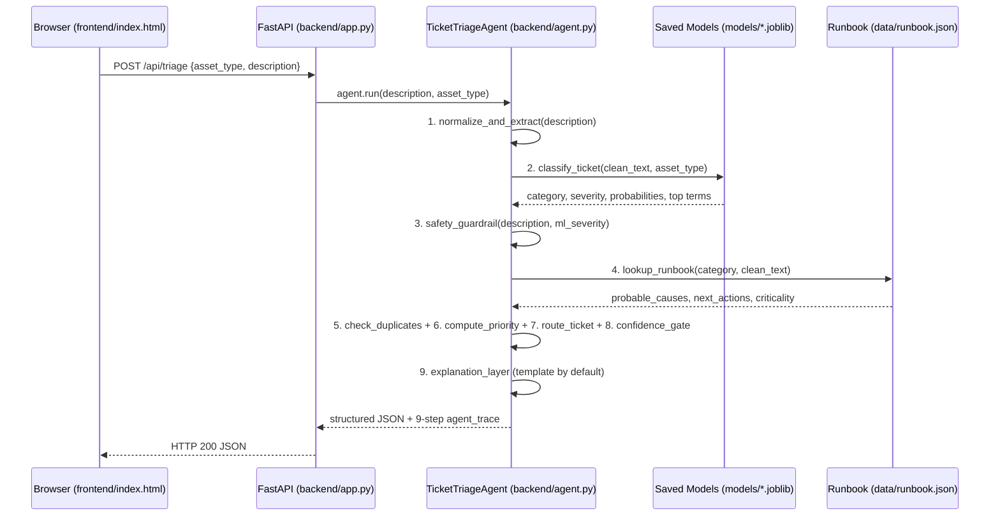
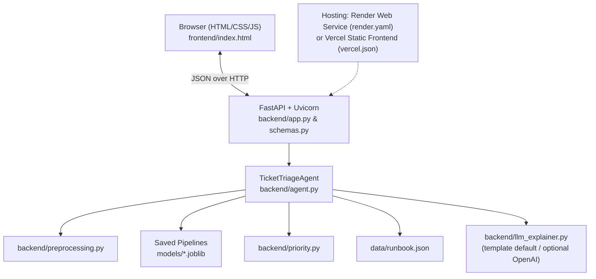

# PROJECT_EXPLAINED.md — Complete Guide to the Maintenance Ticket Prioritization Agent

**Author:** Nagavamshi Yamjala (Vamshi)  
**Date:** 2026-11-12  
**Labels used in this document:**
- `[THIS PROJECT]` — what my code in this repository actually does.
- `[INDUSTRY CONTEXT]` — how similar systems are generally used in real-world operations.
- `[FUTURE]` — what could be added later, but is **not built** yet.

---

## 1. The Project in One Minute

- **Problem:** Renewable-energy control rooms receive free-text maintenance tickets where urgent safety or generation-loss faults can be buried in inconsistent wording or read too late.
- **Solution:** `[THIS PROJECT]` I built a hybrid ticket triage agent that combines a scikit-learn text classifier with deterministic (rule-based) safety escalation, local runbook retrieval, transparent priority scoring, and team/SLA routing.
- **Result:** `[THIS PROJECT]` It runs 100% offline with no API key, achieves `0.8724` category macro-F1 and `0.1333` under-triage on a separate 30-ticket hand-written challenge set, and logs a 9-step reasoning trace for every decision.

**Real-Life Analogy:**  
Think of a **hospital triage nurse**. When patients walk into an emergency room, the nurse does not perform surgery—the nurse listens to the symptoms, checks vital signs for immediate red flags (chest pain -> immediate emergency), assigns an urgency level, and routes the patient to the right specialist.  
**Where the analogy stops:** A hospital nurse has years of clinical training and live patient vitals; `[THIS PROJECT]` only reads short English text plus `asset_type` on synthetic training data, and never inspects live SCADA sensor streams or takes physical action.

---

## 2. The Problem in Plain Words

A **maintenance ticket** is a short text note logged by a field technician, operator, or automated monitoring system describing something broken, overdue, or unsafe at a power plant.

Three real examples from [maintenance_tickets.csv](file:///c:/Users/vamsh/Downloads/04_maintenance_ticket_prioritization_agent/04_maintenance_ticket_prioritization_agent/data/maintenance_tickets.csv):
1. **Solar (`T001`):** `"Inverter 4 tripping repeatedly after noon, high temperature alarm visible"` (`high`, `inverter_thermal`)
2. **Wind (`T002`):** `"Gearbox vibration has increased for turbine WTG-12 with abnormal noise"` (`critical`, `gearbox_vibration`)
3. **Grid (`T006`):** `"Curtailment instruction not reflected in generation dashboard"` (`medium`, `grid_curtailment`)

**Why manual triage is slow and risky:**
- **Volume & noise:** Operators write with abbreviations (`WTG`, `SCADA`, `ICR`, `RTU`), typos (`temprature`, `vibraton`), and inconsistent casing.
- **Hidden urgency:** A critical hazard (e.g., `"smoke"`, `"arc flash"`, `"unable to feather"`) may sit inside a long sentence or look like a routine note.
- **Cost of late triage:** Missing a critical fault causes **generation loss** (megawatt-hours not produced), **equipment damage** (e.g., gearbox seizure), **safety risk** (fire, arc flash), or **compliance penalties** (missed statutory inspections).
- **Who feels the pain:** Control-room operations analysts (triage bottleneck), O&M supervisors (dispatching teams), maintenance planners (scheduling), and safety officers (EHS compliance).

---

## 3. What the System Does (Inputs and Outputs)

### Input / Output Table `[THIS PROJECT]`

| Direction | Field | Plain-Language Meaning |
|---|---|---|
| **Input** | `asset_type` | Plant type: `solar`, `wind`, `hydro`, or `grid`. |
| **Input** | `description` | Free-text ticket (5 to 2,000 characters). |
| **Input** | `ticket_id` (optional) | Identifier such as `DEMO-01` (defaults to `ADHOC`). |
| **Output** | `category` | Predicted fault type (one of 10 categories, e.g., `gearbox_vibration`). |
| **Output** | `severity` | Final urgency tier: `low`, `medium`, `high`, or `critical`. |
| **Output** | `guardrail_escalated` | `true` if deterministic safety rules raised severity above the ML prediction. |
| **Output** | `priority_score` | Weighted `0–100` score ranking urgency across tickets. |
| **Output** | `owner_team` & `sla_hours` | Assigned team and response target (`1h`, `4h`, `24h`, or `72h`). |
| **Output** | `probable_causes` | Ranked **candidates to check** from the local runbook (not confirmed root causes). |
| **Output** | `next_actions` | Recommended first troubleshooting steps from the runbook. |
| **Output** | `confidence` | Model probability for category, severity, and margin between top-2 categories. |
| **Output** | `needs_human_review` | `true` when model confidence or top-2 margin is below threshold. |
| **Output** | `agent_trace` | Ordered list of all 9 tool steps and their outputs. |

**What the system deliberately does NOT do `[THIS PROJECT]`:**
- It does **not** send commands to turbines, inverters, or SCADA.
- It does **not** replace the O&M engineer—it proposes probable causes *to check*, never confirmed diagnoses.
- It does **not** connect to a live CMMS database (`[FUTURE]`).

---

## 4. The Complete Flow, End to End

### 4.1 Pipeline Flowchart `[THIS PROJECT]`

```mermaid
flowchart LR
    U["User Types Ticket in UI"] --> API["FastAPI: POST /api/triage"]
    API --> S1["1. normalize_and_extract\n(clean text, regex IDs)"]
    S1 --> S2["2. classify_ticket\n(TF-IDF + LogReg)"]
    S2 --> S3["3. safety_guardrail\n(escalate-only hazard rules)"]
    S3 --> S4["4. lookup_runbook\n(TF-IDF cosine over runbook.json)"]
    S4 --> S5["5. check_duplicates\n(Jaccard over last 50 tickets)"]
    S5 --> S6["6. compute_priority\n(weighted 0-100 score)"]
    S6 --> S7["7. route_ticket\n(owner team + SLA)"]
    S7 --> S8["8. confidence_gate\n(needs_human_review flag)"]
    S8 --> S9["9. explanation_layer\n(template or optional LLM)"]
    S9 --> RES["JSON Response -> UI"]
```



### 4.2 Sequence Diagram `[THIS PROJECT]`



### 4.3 20-Second Whiteboard ASCII Flow
```text
[Ticket + Asset] -> Clean/IDs -> TF-IDF+LogReg -> Safety Guardrail (escalate only) -> Runbook + Duplicates -> Priority + Route + Review Gate -> Template/LLM -> UI
```

### 4.4 Step-by-Step Walkthrough 1: Wind Gearbox Demo (`DEMO-02`, Real Run)
Input: `asset_type = "wind"`, `description = "WTG-12 gearbox vibration spike with loud grinding noise and metallic debris suspected"`

| Step | Tool | Real Input | Real Output | Why It Matters |
|---:|---|---|---|---|
| 1 | `normalize_and_extract` | Raw description | `clean_text: "wtg-12 gearbox vibration spike..."`, `equipment_ids: ["WTG-12"]` | Strips noise and tags the exact turbine ID. |
| 2 | `classify_ticket` | `clean_text`, `"wind"` | `category: "gearbox_vibration"` (`0.8858`), `ml_severity: "critical"` (`0.9141`) | Proposes category, severity, and confidence. |
| 3 | `safety_guardrail` | Raw text, `"critical"` | `final_severity: "critical"`, `escalated: false`, `safety_flag: true` (`SAF-02-CRITICAL-FAULT`: `"metallic debris"`) | Marks safety flag and guarantees critical floor. |
| 4 | `lookup_runbook` | `"gearbox_vibration"`, `clean_text` | `RB-GBX-01`, `owner_team: "Wind Mechanical & CMS Team"`, 3 causes, 3 actions | Gives the analyst immediate next checks. |
| 5 | `check_duplicates` | `clean_text`, `"wind"` | `duplicate_count: 0`, `is_repeat_fault: false` | Checks if this is a repeat fault in last 50 tickets. |
| 6 | `compute_priority` | `critical`, `0.95`, `0.9`, `safety=True`, `dup=0` | `priority_score: 92.0` | Produces a single comparable 0–100 rank. |
| 7 | `route_ticket` | `gearbox_vibration`, `wind`, `critical`, `92.0` | `Wind Mechanical & CMS Team`, `sla_hours: 1`, `Tier-1 Immediate Dispatch` | Routes to the right team with a 1-hour SLA. |
| 8 | `confidence_gate` | `cat_conf=0.8858`, `margin=0.8629` | `needs_human_review: false` | Confirms high model certainty. |
| 9 | `explanation_layer` | Structured fields | `"Classified as gearbox_vibration (critical severity, priority 92.0/100)..."` (`template`) | Summarizes the decision in plain English. |

### 4.5 Walkthrough 2: Guardrail Escalation (`GUARD-01`, Real Run)
Input: `asset_type = "solar"`, `description = "Smoke observed from DC combiner box 3 in Block 2 during routine walkdown"`
- **Step 2 (`classify_ticket`):** ML predicted `category: "inverter_thermal"` (`0.2593` confidence) and `ml_severity: "high"` (`0.2846` confidence).
- **Step 3 (`safety_guardrail`):** Rule `SAF-01-FIRE-ARC` matched `"smoke"` and **escalated severity from `high` to `critical`** (`guardrail_escalated: true`), raising `priority_score` to `89.0` and SLA to `1 hour`.
- **Step 8 (`confidence_gate`):** Because `category_confidence` (`0.26 < 0.45`) and `top2_category_margin` (`0.09 < 0.12`) were low, it set `needs_human_review: true`.

### 4.6 Walkthrough 3: Challenge-Set Miss (`CHG-07`, Real Run)
Input: `asset_type = "grid"`, `description = "Oil dripping steadily from Main Transformer TX-2 radiator flange and Buchholz gas alert active"` (True label: `transformer_fault` / `critical`).
- **What happened:** ML predicted `transformer_fault` (`0.7751`) and `ml_severity: "high"` (`0.5064`), and `safety_guardrail` matched `"buchholz"` (minimum `high`), so `final_severity` stayed `high` (`severity_error = -1`, under-triaged by 1 tier, `priority_score = 80.8`, `sla_hours = 4`).
- **Why (hypothesis):** Synthetic training data used `"oil leak"` rather than `"oil dripping"`, so `"dripping"` had no critical weight.

---

## 5. How Each Part Works (Real Settings)

1. **Data (`data/`):**
   - *Idea:* 6 bundled rows cannot train or test an ML model.
   - *Code & parameters:* [maintenance_tickets.csv](file:///c:/Users/vamsh/Downloads/04_maintenance_ticket_prioritization_agent/04_maintenance_ticket_prioritization_agent/data/maintenance_tickets.csv) (**6 rows**, untouched), [maintenance_tickets_synthetic.csv](file:///c:/Users/vamsh/Downloads/04_maintenance_ticket_prioritization_agent/04_maintenance_ticket_prioritization_agent/data/maintenance_tickets_synthetic.csv) (**420 rows**, `seed=42`, 10 categories), and [challenge_tickets.csv](file:///c:/Users/vamsh/Downloads/04_maintenance_ticket_prioritization_agent/04_maintenance_ticket_prioritization_agent/data/challenge_tickets.csv) (**30 hand-written rows**, never used in training).
2. **Text-to-Numbers (`TF-IDF`):**
   - *Idea:* Computers need numbers, not words. TF-IDF gives higher weight to words/character chunks that appear often in one ticket type and rarely across all tickets.
   - *Code & parameters:* `ColumnTransformer` in [train.py](file:///c:/Users/vamsh/Downloads/04_maintenance_ticket_prioritization_agent/04_maintenance_ticket_prioritization_agent/backend/train.py) combines word n-grams (`ngram_range=(1,2)`, `min_df=2`), character n-grams (`analyzer="char_wb"`, `ngram_range=(3,5)`, `min_df=3` for typos like `Invertr`), and `OneHotEncoder` on `asset_type`.
3. **Classifier & Baseline:**
   - *Idea:* Compare a simple rule baseline against linear text classifiers.
   - *Code & parameters:* Main model is `LogisticRegression(C=2.0, class_weight="balanced", max_iter=1000, random_state=42)`. Chosen over `LinearSVC` and `MultinomialNB` because it outputs probabilities for the confidence gate, word weights for highlighting, and the lowest challenge-set under-triage (`0.1333`).
4. **Ordinal Severity & Sign Convention:**
   - *Idea:* `low (0) < medium (1) < high (2) < critical (3)`.
   - *Code & parameters:* `severity_error = predicted_level - actual_level`. Negative means **under-triaged** (dangerous: e.g., predicting `high` for `critical` = `-1`).
5. **Safety Guardrail:**
   - *Idea:* Deterministic rules catch life-safety or high-consequence keywords regardless of ML phrasing.
   - *Code & parameters:* 3 rule groups in [agent.py](file:///c:/Users/vamsh/Downloads/04_maintenance_ticket_prioritization_agent/04_maintenance_ticket_prioritization_agent/backend/agent.py) (`SAF-01-FIRE-ARC`, `SAF-02-CRITICAL-FAULT`, `SAF-03-HAZARD-ESCALATION`) with a 15-character negation check (`"no "`, `"not "`, `"without "`). **Escalate-only** — never downgrades.
6. **Runbook Retrieval (NOT LLM-RAG):**
   - *Idea:* Match the ticket to pre-written O&M troubleshooting steps.
   - *Code & parameters:* TF-IDF cosine similarity over [runbook.json](file:///c:/Users/vamsh/Downloads/04_maintenance_ticket_prioritization_agent/04_maintenance_ticket_prioritization_agent/data/runbook.json). Because no LLM generates from the retrieved text, this is **retrieval, not LLM-RAG**.
7. **Priority Score (`backend/priority.py`):**
   - *Formula:* `priority_score = 100 * (0.45 * severity_weight + 0.20 * asset_criticality + 0.20 * generation_loss_risk + 0.10 * safety_flag + 0.05 * min(duplicate_count, 3) / 3)`
   - *Worked Example (`DEMO-02`):* `100 * (0.45*1.0 + 0.20*0.95 + 0.20*0.90 + 0.10*1 + 0.05*0) = 100 * (0.45 + 0.19 + 0.18 + 0.10 + 0) = 92.0`.
8. **Confidence Gate:**
   - *Parameters:* Sets `needs_human_review = true` if `category_confidence < 0.45`, `top2_category_margin < 0.12`, or (`severity_confidence < 0.40` and not escalated).
9. **Optional LLM Layer (`backend/llm_explainer.py`):**
   - *Parameters:* `LLM_PROVIDER=none` by default. Never alters category, severity, or priority. If enabled, sends only verified structured fields, retries once, and falls back to `_template_explanation()`.
10. **Evaluation (`docs/evaluation_results.json`):**
    - *5-Fold CV (426 synthetic+bundled rows):* Category Macro-F1 `1.0000 ± 0.0000`, Severity Accuracy `0.9320 ± 0.0342`, Critical Recall `0.9399 ± 0.0612`, Under-Triage `0.0352 ± 0.0257`. *(Warning: the `1.0` category F1 reflects synthetic template separability, NOT real-world difficulty.)*
    - *30-Ticket Challenge Set (Honest Generalisation):* LogReg Category Macro-F1 `0.8724`, Critical Recall `0.5714`, Under-Triage `0.1333` (vs `0.3667` for Keyword Baseline and `0.2000` for MultinomialNB).

---

## 6. System Architecture

### Architecture Diagram `[THIS PROJECT]`


### Folder Map (Walkthrough Order)
- [README.md](file:///c:/Users/vamsh/Downloads/04_maintenance_ticket_prioritization_agent/04_maintenance_ticket_prioritization_agent/README.md) — Overview, setup, and production gaps (open 1st).
- [backend/preprocessing.py](file:///c:/Users/vamsh/Downloads/04_maintenance_ticket_prioritization_agent/04_maintenance_ticket_prioritization_agent/backend/preprocessing.py) — Text cleaning, regex ID extraction, deduplication (open 2nd).
- [backend/train.py](file:///c:/Users/vamsh/Downloads/04_maintenance_ticket_prioritization_agent/04_maintenance_ticket_prioritization_agent/backend/train.py) & [backend/evaluate.py](file:///c:/Users/vamsh/Downloads/04_maintenance_ticket_prioritization_agent/04_maintenance_ticket_prioritization_agent/backend/evaluate.py) — Model training, CV, challenge-set eval, ablation (open 3rd).
- [backend/priority.py](file:///c:/Users/vamsh/Downloads/04_maintenance_ticket_prioritization_agent/04_maintenance_ticket_prioritization_agent/backend/priority.py) — Priority score formula and team/SLA routing (open 4th).
- [backend/agent.py](file:///c:/Users/vamsh/Downloads/04_maintenance_ticket_prioritization_agent/04_maintenance_ticket_prioritization_agent/backend/agent.py) & [backend/llm_explainer.py](file:///c:/Users/vamsh/Downloads/04_maintenance_ticket_prioritization_agent/04_maintenance_ticket_prioritization_agent/backend/llm_explainer.py) — 9-step tool pipeline, guardrail, runbook lookup, explainer (open 5th).
- [backend/app.py](file:///c:/Users/vamsh/Downloads/04_maintenance_ticket_prioritization_agent/04_maintenance_ticket_prioritization_agent/backend/app.py) & [frontend/index.html](file:///c:/Users/vamsh/Downloads/04_maintenance_ticket_prioritization_agent/04_maintenance_ticket_prioritization_agent/frontend/index.html) — API routes and control-room UI (open 6th).

### Tech Stack Table
| Choice | Why Selected |
|---|---|
| **FastAPI + Pydantic** | Fixed by starter; automatic input validation (`422`) and OpenAPI docs (`/docs`). |
| **scikit-learn (TF-IDF + LogReg)** | Fast (<5 ms), works on small data, outputs probabilities and interpretable term weights. |
| **pandas + NumPy + joblib** | Clean CSV handling and fast model serialization (`983.83 KB` total). |
| **Plain HTML/CSS/JS** | Zero build step; served directly by FastAPI or Vercel static CDN. |
| **pytest + httpx** | Deterministic unit and API integration testing. |

---

## 7. A Tour of the User Interface

*(Note: Live server verified at `http://127.0.0.1:8000/` returning HTTP `200`; screenshots were not captured from this terminal.)*

- **Header:** Title + live `Backend: Ready` status pill (pings `/api/health` on load).
- **Tab 1 — Triage Console:**
  - Left column: `asset_type` dropdown, ticket description box, **Run Triage Agent** button, 3 one-click **Rehearsed Demo Tickets**, and **Why This Prediction** card highlighting contributing terms in green (`<mark>`).
  - Right column: **Triage Decision** card (severity badge, guardrail-escalated badge, human-review badge, category, priority `/100`, SLA, owner team, confidence), **Runbook Evidence** (probable causes to check & next actions), and **Agent Tool Trace** (steps 1–9).
- **Tab 2 — Evaluation Metrics:** Fetches `/api/metrics` live to render 5-fold CV KPIs, model comparison table, ablation table, and severity confusion matrix.
- **Tab 3 — Limitations & Formula:** Displays the priority formula and honest prototype limitations.

---

## 8. Where This Kind of System Is Used `[INDUSTRY CONTEXT]`

- **Primary Setting:** Renewable-energy O&M control rooms (solar parks, wind farms, hydro stations, pooling substations) and asset-management teams.
- **How It Fits in Real Operations `[INDUSTRY CONTEXT]`:** Sits as a decision-support layer between SCADA alarms / operator logs and a CMMS (Computerized Maintenance Management System) like SAP PM or IBM Maximo, with a human analyst approving dispatches.
- **Important Disclaimer:** `[THIS PROJECT]` is a **prototype** trained on dummy and synthetic data and is **not** deployed in any real plant or company.

### Related Fields Where the Same Pattern (`Classify -> Prioritize -> Route`) Fits `[INDUSTRY CONTEXT]`

| Field | Equivalent "Ticket" | Equivalent "Severity" | Why This Pattern Fits |
|---|---|---|---|
| **Utilities & Substations** | Relay trip or transformer oil alarm note | Grid outage / equipment-trip risk | Safety guardrails prevent missing HV hazards. |
| **Manufacturing Plants** | Shop-floor machine breakdown log | Line-stop vs minor maintenance | Routes mechanical vs electrical faults fast. |
| **Oil & Gas** | Pipeline pressure / leak inspection note | Safety/environmental hazard tier | Escalate-only rules protect EHS compliance. |
| **Telecom Towers** | Tower power/rectifier or backhaul fault | Site-down vs battery-low warning | Prioritizes high-traffic tower dispatch SLAs. |
| **Facility Management** | HVAC, elevator, or fire-panel request | Safety/tenant-impact urgency | Separates emergencies from routine backlog. |
| **IT Service Desks** | Incident / outage report | P1 (outage) to P4 (question) | Routes to Network, DB, or App teams with SLAs. |
| **Customer Support** | Inbound email / chat complaint | Churn, billing, or legal risk | Confidence gate flags ambiguous cases to humans. |
| **Healthcare Triage** | Patient intake symptom summary | Emergency vs urgent vs routine | Never auto-downgrades red-flag symptoms. |

---

## 9. Business Value and Success Measures

- **What Improves `[INDUSTRY CONTEXT]`:** Faster time-to-triage, fewer missed critical faults, consistent priority scoring across shifts, reduced analyst cognitive load, and an auditable trace of every decision.
- **How Success Would Be Measured in Production `[FUTURE]`:**
  1. **Critical Recall** (fraction of true critical tickets caught).
  2. **Under-Triage Rate** (fraction of tickets scored lower than true severity).
  3. **Mean Time-to-First-Response (MTTR / SLA adherence)**.
  4. **Human Override Rate** (how often O&M engineers change the predicted category, severity, or team).

---

## 10. Limitations and What I Would Build Next

**Honest Limitations `[THIS PROJECT]`:**
- Only **6** real bundled tickets; model trained on **420** synthetic tickets.
- Single-label primary category assumption (compound faults like `CHG-16` get one category).
- Bag-of-words TF-IDF struggles with negation (`CHG-11`: `"no alarm present"` predicted `high` instead of `low`).
- Duplicate check uses an in-memory 50-ticket buffer, not a database.
- English only; no authentication, drift monitoring, or live CMMS integration.

**Production-Readiness Roadmap `[FUTURE]`:**
1. **Data:** Collect 500–1,000+ real CMMS tickets reviewed by O&M engineers.
2. **Model:** Add negation-aware or pretrained text embeddings while keeping the deterministic safety guardrail.
3. **Integration:** Connect to CMMS webhooks/APIs for persistent duplicate lookup and ticket creation.
4. **Feedback & Monitoring:** Log analyst overrides, track confidence/drift, and retrain on verified labels.
5. **Security:** Add SSO/RBAC authentication and an immutable audit database.

---

## 11. Glossary (Plain Words)

1. **Ticket:** A short text record describing a maintenance issue or fault.
2. **Severity:** How urgent and dangerous the issue is (`low`, `medium`, `high`, `critical`).
3. **SLA (Service Level Agreement):** Target maximum time to respond (e.g., 1 hour for `critical`).
4. **SCADA:** Supervisory Control and Data Acquisition — plant monitoring software.
5. **CMMS:** Computerized Maintenance Management System — software used to track work orders.
6. **O&M:** Operations and Maintenance.
7. **WTG:** Wind Turbine Generator.
8. **Inverter:** Solar equipment that converts DC power from panels into AC grid power.
9. **MPPT:** Maximum Power Point Tracking — inverter control that maximizes solar output.
10. **Curtailment:** Reducing plant power export on grid operator instruction.
11. **TF-IDF:** Term Frequency–Inverse Document Frequency — converts text into weighted word/character numbers.
12. **Classification:** Predicting a discrete label (like category) rather than a continuous number.
13. **Baseline:** A simple benchmark (here, keyword + majority class) used to prove ML adds value.
14. **Precision:** Of tickets predicted as class X, how many actually belong to class X.
15. **Recall:** Of all true class X tickets, how many the model caught.
16. **Macro-F1:** Average F1 score across all classes equally, so rare classes matter as much as common ones.
17. **Confusion Matrix:** A table comparing actual labels (rows) against predicted labels (columns).
18. **Cross-Validation:** Splitting data into *k* folds and testing on each fold to measure stability (`mean ± std`).
19. **Data Leakage:** Accidentally letting test information into training (prevented here by deduplicating first and fitting TF-IDF on train folds only).
20. **Guardrail:** A deterministic safety rule that overrides ML when specific hazard keywords appear.
21. **Agent:** A system that executes ordered tool calls with conditional branching and state.
22. **Tool Calling:** Invoking discrete, single-purpose functions (e.g., `lookup_runbook`, `compute_priority`) in a pipeline.
23. **Retrieval:** Searching a local knowledge base (`runbook.json`) for relevant instructions.
24. **RAG:** Retrieval-Augmented Generation — feeding retrieved documents into an LLM to generate text (not used here).
25. **LLM:** Large Language Model (optional here and off by default).
26. **Hallucination:** When an LLM invents facts not supported by the input.
27. **API / Endpoint:** A web URL (e.g., `POST /api/triage`) that accepts structured requests and returns data.
28. **JSON:** JavaScript Object Notation — structured key-value text format used by APIs.
29. **Deployment:** Hosting the app on a server (e.g., Render) so others can access it via a URL.
30. **Cold Start:** Delay (50–60s on Render free tier) when a sleeping server wakes up for the first request.

---

## 12. Ready-Made Explanations (Spoken Scripts)

### 30-Second Version (For a Manager)
> "Renewable-energy control rooms get free-text maintenance tickets every shift, and missing a critical fault causes downtime and safety risks. I built a triage agent that reads the ticket, predicts the fault category and urgency, applies deterministic safety rules that can only escalate hazards, attaches probable causes and next actions from an O&M runbook, and routes the ticket with an SLA—all offline with a full audit trace."

### 2-Minute Version (For a Technical Interviewer)
> "**Problem:** Control-room O&M analysts need fast, safe triage across solar, wind, hydro, and grid tickets where under-triaging a critical fault is far costlier than a false alarm. **Data:** Because the bundled CSV has only 6 rows, I kept it untouched, generated 420 seeded synthetic tickets across 10 categories, and hand-wrote a separate 30-ticket challenge set with typos and negations never used in training. **Model:** I used word and character TF-IDF plus `asset_type` one-hot encoding with balanced Logistic Regression—chosen over LinearSVC and Naive Bayes because it gives calibrated-style probabilities and word weights. **Agent:** The model proposes category and severity, then an 8-tool pipeline runs an escalate-only safety guardrail, TF-IDF runbook retrieval, duplicate detection, a transparent 0–100 priority formula, team/SLA routing, and a confidence gate that flags uncertain tickets for human review. **Results:** On 5-fold CV it gets `0.94` critical recall, and on the harder challenge set it achieves `0.87` category macro-F1 and `13.3%` under-triage versus `36.7%` for the keyword baseline. **Limitation:** It is trained on synthetic data and bag-of-words struggles with negation, so the next step is training on real CMMS tickets."

### "Explain It to a Friend" (5 Sentences, No Jargon)
> "Imagine a solar or wind farm where workers type quick notes whenever something breaks. My program reads those notes and figures out what kind of problem it is and how urgent it is. It also has strict safety rules—so if a note mentions smoke or sparks, it immediately marks it as an emergency. Then it looks up a checklist of what to check first and sends the note to the right repair team with a deadline. If the program is not sure, it raises a flag asking a human to double-check."

### Whiteboard Plan (Draw Left to Right, 4 Strokes)
1. **Stroke 1 (Input):** Draw `[Ticket Text + Asset]` -> say *"An analyst or operator submits free text."*
2. **Stroke 2 (ML Proposal):** Draw `-> [TF-IDF + LogReg]` -> say *"ML predicts category, severity, and confidence."*
3. **Stroke 3 (Safety & Knowledge):** Draw `-> [Escalate-Only Guardrail] -> [Runbook + Priority]` -> say *"Rules can only escalate hazards; runbook gives next actions and a 0–100 priority."*
4. **Stroke 4 (Decision):** Draw `-> [Team + SLA + Review Flag]` -> say *"Routes to the right team, or flags a human if unsure."*

### 5 Likely Follow-Up Questions (3-Sentence Answers)
1. **Where would this sit in a real company's stack?**  
   It would sit between the ticketing/CMMS intake form (or SCADA alert feed) and the control-room dispatch queue as a decision-support API. Every ticket would be scored automatically, and analysts would see the suggested team, SLA, and probable causes before confirming dispatch. Currently, my prototype runs standalone without CMMS integration.
2. **Could a plant operator trust it on safety-critical faults?**  
   They should never trust ML blindly, which is why I added a deterministic escalate-only safety guardrail and a human-review confidence gate. The system never takes physical action on equipment and frames root causes as candidates to check. In production, it would still require engineer sign-off and real historical validation.
3. **How would you handle a brand-new fault type?**  
   In the current prototype, an unseen fault type will receive low probability and a small margin between top-2 categories, which triggers `needs_human_review = true`. Those flagged tickets go to a human analyst, whose labels are collected for periodic retraining. Automated drift monitoring and retraining are planned future steps.
4. **Why not just send every ticket to ChatGPT/GPT-4?**  
   External LLMs add latency, cost, internet dependency, and secret-management requirements, and they can hallucinate causes or inconsistent severities. My core pipeline runs offline in milliseconds using deterministic Python and scikit-learn. An optional LLM layer is off by default and can only summarize already-verified fields.
5. **What happens if two teams disagree on the priority score?**  
   The priority formula is completely transparent—weighted across severity (`45%`), asset criticality (`20%`), generation loss risk (`20%`), safety flag (`10%`), and repeat count (`5%`). Operations managers can adjust those weights in `backend/priority.py` without retraining the ML model. Every ticket response includes the exact component breakdown.

---

## 13. Self-Check & Claims Audit

| Claim | Label | Evidence (File or Command) |
|---|---|---|
| 6 bundled + 420 synthetic + 30 challenge tickets | `THIS PROJECT` | `data/*.csv` verified via pandas |
| 9-step agent pipeline with escalate-only guardrail | `THIS PROJECT` | `backend/agent.py` + live `POST /api/triage` |
| Challenge-set `0.8724` Cat F1, `0.1333` under-triage | `THIS PROJECT` | `docs/evaluation_results.json` (`python -m backend.evaluate`) |
| `GUARD-01` escalated `high -> critical` on `"smoke"` | `THIS PROJECT` | Live `POST /api/triage` run captured above |
| `CHG-07` under-triaged (`high` vs `critical`, `-1`) | `THIS PROJECT` | `docs/evaluation_results.json` + live `POST /api/triage` |
| Decision-support alongside CMMS/SCADA in O&M | `INDUSTRY CONTEXT` | General renewable O&M / ITIL triage practice |
| Feedback retraining, drift monitoring, CMMS API, SSO | `FUTURE` | Not built; listed in `README.md` & Section 10 |
