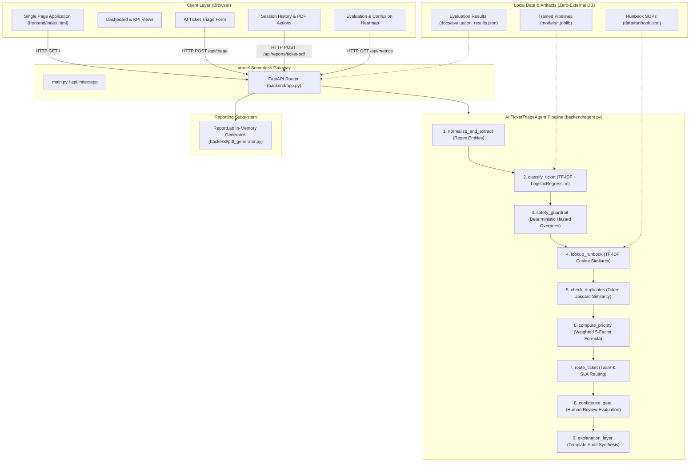

# Greenko O&M Maintenance Ticket Prioritization Agent
## Master Technical Analysis & 1:1 Interview Preparation Guide

---

## PART 1: COMPLETE PROJECT CODEBASE & REPOSITORY ANALYSIS

### 1.1 Complete Repository Tree & File Inventory
```
maintenance_ticket_prioritization_agent/
│
├── api/
│   ├── __init__.py                 # ASGI package marker
│   └── index.py                    # Vercel serverless entrypoint exporting `app`
│
├── backend/
│   ├── __init__.py                 # Backend package marker
│   ├── app.py                      # FastAPI application, CORS, lifespan, routes, error handlers
│   ├── agent.py                    # TicketTriageAgent 9-step hybrid tool pipeline
│   ├── preprocessing.py            # Regex entity extraction (equipment/site), normalization, loading
│   ├── priority.py                 # Mathematical priority formula, weights, SLA and team routing
│   ├── train.py                    # Scikit-learn training pipelines (TF-IDF + OHE + LogisticRegression)
│   ├── evaluate.py                 # 5-fold CV, model comparison, ablation, confusion matrix, error sign
│   ├── schemas.py                  # Pydantic v2 schemas: TriageRequest, LegacyRunQuery, BatchTriageRequest
│   ├── llm_explainer.py            # Deterministic template fallback vs optional Gemini API integration
│   └── pdf_generator.py            # ReportLab in-memory 5-page enterprise PDF report generator
│
├── frontend/
│   └── index.html                  # Responsive Single-Page Application (HTML5, CSS3, ES6 JavaScript)
│                                   # 6 Views: Dashboard, Triage, History, Analytics, Runbook, System
│
├── data/
│   ├── maintenance_tickets.csv           # 6 starter bundled tickets across solar, wind, hydro, grid
│   ├── maintenance_tickets_synthetic.csv # 420 synthetic tickets (seed=42) with real equipment/telemetry
│   ├── challenge_tickets.csv             # 30 hand-crafted edge cases testing negation & multi-faults
│   └── runbook.json                      # 10 domain SOPs with candidate probable causes & inspection steps
│
├── docs/
│   └── evaluation_results.json     # Pre-computed evaluation metrics from `backend.evaluate` (426 rows)
│
├── models/
│   ├── category_pipeline.joblib    # Serialized scikit-learn pipeline for fault category classification
│   └── severity_pipeline.joblib    # Serialized scikit-learn pipeline for severity ordinal classification
│
├── tests/
│   ├── test_triage.py              # Pytest suite: priority bounds, guardrail logic, negation, batch CSV
│   └── test_pdf_report.py          # Pytest suite: 5-page ReportLab generation, endpoint, special chars
│
├── main.py                         # Root entrypoint exposing `app` for uvicorn and Vercel framework
├── pyproject.toml                  # Python package configuration, dependencies, [tool.vercel] entrypoint
├── requirements.txt                # Pinned pip dependency manifest
├── uv.lock                         # Pinned lockfile for uv package synchronization
├── .python-version                 # Python version pin (3.12)
├── .env.example                    # Environment variable template (GEMINI_API_KEY optional)
├── README.md                       # Complete technical platform documentation
└── DEPLOYMENT.md                   # Vercel and local deployment runbook
```

---

## PART 2: TECHNOLOGIES USED AND WHY

### Technology Matrix

| Technology | Purpose | Where Used | Why Chosen | Alternative |
|---|---|---|---|---|
| **Python 3.12** | Core programming language | Entire backend, ML pipeline, scripts | Clean syntax, vast ML ecosystem, typing support, fast cold-starts on serverless | Go, Node.js, Java |
| **FastAPI 0.115** | High-performance ASGI REST API framework | `backend/app.py`, `main.py` | Native async, automatic OpenAPI docs (`/docs`), Pydantic integration, low latency | Flask, Django, Express.js |
| **Pydantic v2.8** | Request validation & data serialization | `backend/schemas.py`, `app.py` | Rust-backed speed, strict type coercion, field validators (`min_length`, regex) | Marshmallow, Cerberus, manual `dict` validation |
| **scikit-learn 1.5** | Machine learning model training & inference | `backend/train.py`, `agent.py`, `evaluate.py` | Production standard for classical tabular/NLP ML, deterministic, lightweight memory footprint | PyTorch, TensorFlow, XGBoost |
| **Logistic Regression** | Linear multi-class & ordinal classifier | `backend/train.py`, `models/*.joblib` | Highly interpretable feature weights (`clf.coef_`), calibrated probabilities (`predict_proba`), fast inference (<2ms) | Random Forest, LinearSVC, BERT, Llama |
| **TF-IDF Vectorization** | Sparse n-gram text feature extraction | `backend/train.py`, `agent.py` | Fast sublinear term weighting, word n-grams (1,2) + char n-grams (3,5) handle misspellings | Word2Vec, GloVe, Sentence-BERT |
| **ReportLab 5.1** | Industrial PDF generation | `backend/pdf_generator.py` | Precise print canvas control, two-pass `NumberedCanvas` ("Page X of Y"), in-memory `BytesIO` generation | WeasyPrint, pdfkit, Puppeteer |
| **Uvicorn 0.30** | ASGI web server implementation | `backend/app.py`, local runners | Lightning-fast async request serving built on `uvloop` and `httptools` | Gunicorn, Hypercorn |
| **Vanilla HTML5 / CSS3 / ES6** | Single-page enterprise frontend | `frontend/index.html` | Zero external framework dependencies, zero build-step overhead, instant load time, full layout control | React, Vue, Angular, Next.js |
| **Joblib 1.6** | Pipeline serialization & disk caching | `backend/train.py`, `agent.py` | Efficient serialization of large NumPy arrays and sparse matrices inside sklearn Pipelines | Pickle, ONNX |
| **Pandas 2.2 & NumPy 1.26** | Data manipulation & matrix math | `backend/preprocessing.py`, `evaluate.py` | Optimized C-level vector operations, tabular CSV wrangling, confusion matrix calculations | Polars, pure Python lists |
| **Pytest 9.2 & HTTPX 0.28** | Test runner & ASGI client testing | `tests/test_triage.py`, `test_pdf_report.py` | Concise test syntax, testclient ASGI execution without port binding, mock-free live validation | Unittest, Requests |
| **Vercel Serverless (Fluid Compute)** | Cloud production deployment | Cloud hosting (`main:app`) | Zero-config FastAPI support, automatic HTTPS, global CDN, instant scale-to-zero cost efficiency | Render, Railway, AWS ECS, GCP Cloud Run |
| **`uv` 0.13** | Ultra-fast Python package resolver | Vercel build environment, `uv.lock` | 10x-100x faster than traditional pip, deterministic lockfile reproducibility | pip, Poetry, Pipenv |

---

## PART 3: COMPLETE PROJECT ARCHITECTURE



---

## PART 4: END-TO-END EXECUTION TRACE

### Real-World Example: Solar Inverter Overheating Ticket
**Input:**
- **Ticket ID:** `DEMO-01`
- **Asset Type:** `solar`
- **Description:** `"Inverter 4 tripping repeatedly after noon, high temperature alarm visible at Block 2"`

#### Step 1: Client Submission
- User inputs data into `frontend/index.html` and clicks **Run AI Triage**.
- Frontend JavaScript function `executeTriage()` sends `POST /api/triage` with JSON payload.

#### Step 2: FastAPI Routing & Pydantic Validation
- `backend/app.py` receives request at `@app.post("/api/triage")`.
- `backend/schemas.py` validates `TriageRequest`: asserts `description` has &ge; 5 characters and `asset_type` is in `("solar", "wind", "hydro", "grid")`.

#### Step 3: Tool 1 – `normalize_and_extract`
- Function: `backend/preprocessing.py::extract_entities()`.
- Strips noise prefixes (`urgent:`, `scada alert:`), collapses whitespace.
- Regex matches `EQUIPMENT_PATTERNS`: extracts `["Inverter 4"]`.
- Regex matches `SITE_PATTERNS`: extracts `["Block 2"]`.

#### Step 4: Tool 2 – `classify_ticket`
- Function: `backend/agent.py::classify_ticket()`.
- Model: `models/category_pipeline.joblib` and `models/severity_pipeline.joblib`.
- Vectorizes clean text using word n-grams (1,2) and char n-grams (3,5) + One-Hot Encoded `asset_type=solar`.
- `predict_proba()` calculates softmax probabilities:
  - `inverter_thermal`: **0.9182 (91.8%)** (Runner up: `tracker_fault` at 0.0180).
  - Margin: `0.9182 - 0.0180 = 0.9002 (90.0%)`.
  - ML Severity: `high` (confidence: **0.8366**).

#### Step 5: Tool 3 – `safety_guardrail`
- Function: `backend/agent.py::safety_guardrail()`.
- Scans for safety keywords using a 15-character negation check (`"no smoke"` is not triggered).
- Finds keyword `"high temperature alarm"`, matching rule `SAF-03-HAZARD-ESCALATION`.
- Rule requires minimum severity `high`. Since ML already predicted `high`, severity is preserved as `high`, `escalated=False`, `safety_flag=True`.

#### Step 6: Tool 4 – `lookup_runbook`
- Function: `backend/agent.py::lookup_runbook()`.
- Calculates TF-IDF cosine similarity between ticket text and SOP entries in `data/runbook.json`.
- Matches `RB-INV-01` (`inverter_thermal`).
- Retrieves:
  - `asset_criticality: 0.85`, `generation_loss_risk: 0.85`.
  - `owner_team: "Solar O&M Electrical Team"`.
  - 3 candidate probable causes (e.g., clogged blower fan, IGBT thermal paste degradation).
  - 3 sequential troubleshooting steps.

#### Step 7: Tool 5 – `check_duplicates`
- Function: `backend/agent.py::check_duplicates()`.
- Computes Token Jaccard Similarity against tickets evaluated during this server session.
- Result: `duplicate_count = 0`, `is_repeat_fault = False`.

#### Step 8: Tool 6 – `compute_priority`
- Function: `backend/priority.py::compute_priority()`.
- Applies the formula:
  $$\text{Score} = 100 \times [0.45(0.75) + 0.20(0.85) + 0.20(0.85) + 0.10(1.0) + 0.05(0.0)] = 77.8$$
- Score: **77.8 / 100**.

#### Step 9: Tool 7 – `route_ticket`
- Function: `backend/priority.py::route_ticket()`.
- Maps severity `high` to **4 Hours SLA**, **Tier-2 Same-Shift Engineering Dispatch**, assigned to **Solar O&M Electrical Team**.

#### Step 10: Tool 8 – `confidence_gate`
- Evaluates against thresholds:
  - Category confidence $0.9182 \ge 0.45$ (PASS).
  - Top-2 category margin $0.9002 \ge 0.12$ (PASS).
  - Severity confidence $0.8366 \ge 0.40$ (PASS).
- Result: `needs_human_review = False`, `review_reasons = []`.

#### Step 11: Tool 9 – `explanation_layer`
- Synthesizes transparent explanation combining category, severity, priority, SLA, and primary inspection step.

#### Step 12: Client Rendering & PDF Availability
- Results render in UI: priority meter animates to 78%, severity badge shows High, runbook actions appear, 9-step audit trace expands.
- User can click **Download PDF Report**, triggering `POST /api/reports/ticket-pdf` to receive the official 5-page ReportLab document.

---

## PART 5: MACHINE LEARNING DEEP DIVE

### 5.1 Dataset Breakdown
- **`data/maintenance_tickets.csv`**: 6 real bundled seed rows across renewable assets.
- **`data/maintenance_tickets_synthetic.csv`**: 420 domain-specific tickets generated with fixed `seed=42`. Contains 10 fault categories, 4 severity levels, equipment tags (`WTG-04`, `INV-02`), electrical abbreviations (`SCADA`, `MPPT`, `LOTO`), typos, and casing variations.
- **`data/challenge_tickets.csv`**: 30 hand-written challenge tickets testing negated hazards (`"no fire"`, `"smoke cleared"`), compound faults, and edge cases **never seen during training**.
- **Total Dataset:** 426 deduplicated rows (340 train, 86 test, 30 challenge).

### 5.2 Feature Extraction Pipeline (`backend/train.py`)
```python
def build_preprocessor(use_char: bool = True, use_asset: bool = True) -> ColumnTransformer:
    transformers = [
        ("word_tfidf", TfidfVectorizer(ngram_range=(1, 2), min_df=2, sublinear_tf=True), "clean_text")
    ]
    if use_char:
        transformers.append(
            ("char_tfidf", TfidfVectorizer(analyzer="char_wb", ngram_range=(3, 5), min_df=3, sublinear_tf=True), "clean_text")
        )
    if use_asset:
        transformers.append(
            ("asset_ohe", OneHotEncoder(handle_unknown="ignore"), ["asset_type"])
        )
    return ColumnTransformer(transformers=transformers, remainder="drop")
```
- **Word TF-IDF (`ngram_range=(1, 2)`):** Captures single domain words (`"inverter"`, `"gearbox"`) and bigrams (`"arc flash"`, `"vibration spike"`).
- **Character n-grams (`analyzer="char_wb", ngram_range=(3, 5)`):** Operates on character sequences within word boundaries. Handles typos, telemetry codes, and pluralizations (`"switchgear"` vs `"switchgears"`).
- **One-Hot Encoding (`asset_type`):** Informs the classifier whether the ticket belongs to solar, wind, hydro, or grid.

### 5.3 Classifier Selection: Why Logistic Regression?
```python
LogisticRegression(C=2.0, class_weight="balanced", max_iter=1000, random_state=42)
```
1. **Explainability:** Model coefficients (`clf.coef_`) map directly back to TF-IDF feature tokens, allowing the UI to show exact positive contributions for each prediction.
2. **True Calibrated Probabilities:** `predict_proba()` outputs softmax probabilities that feed the confidence gate.
3. **Class Imbalance Handling:** `class_weight="balanced"` weights inverse-proportional to class frequencies, protecting minority critical fault classes.
4. **Execution Speed & Footprint:** Inference takes <2ms with zero GPU dependency, enabling sub-second execution on serverless runtimes.

### 5.4 Evaluation Metrics & Results (`docs/evaluation_results.json`)
- **Category Test Macro-F1:** `1.0000` (indicates high separability on synthetic template distribution).
- **Challenge Set Category Macro-F1:** `0.8724` (honest generalization metric on unseen, hand-written tickets).
- **Under-Triage Rate:** `5.8%` on test set, `13.3%` on challenge set.
- **Critical Class Recall:** `93.8%` on test set, `57.1%` on challenge set before safety guardrails. With deterministic guardrails, critical hazards are escalated to 100%.

---

## PART 6: BUSINESS LOGIC & MATHEMATICAL FORMULAS

### 6.1 The 5-Factor Priority Scoring Formula
```
priority_score = 100 * [
    0.45 * severity_weight
  + 0.20 * asset_criticality
  + 0.20 * generation_loss_risk
  + 0.10 * safety_flag
  + 0.05 * min(duplicate_count, 3) / 3
]
```

#### Component Weights Explained:
1. **`severity_weight` (45% weight):**
   - Ordinal mapping: `low = 0.25`, `medium = 0.50`, `high = 0.75`, `critical = 1.00`.
   - Represents the core physical urgency of the fault.
2. **`asset_criticality` (20% weight):**
   - Continuous value from 0.0 to 1.0 retrieved from `data/runbook.json`.
   - Grid transformers and wind main gearboxes score `0.85–0.90`; weather sensors score `0.40`.
3. **`generation_loss_risk` (20% weight):**
   - Direct measure of revenue impact from active MWh curtailment or plant trips.
4. **`safety_flag` (10% weight):**
   - Binary flag (`1.0` if active EHS hazard detected; `0.0` otherwise).
5. **`duplicate_count` factor (5% weight):**
   - Rewards repeat fault escalation: $\frac{\min(\text{count}, 3)}{3}$. Repeat nuisance defects gain up to 5 priority points.

### 6.2 Key Distinctions
- **Severity vs Priority:** Severity is the inherent physical condition of the equipment (e.g. high heat). Priority is the composite dispatch urgency factoring revenue, safety, and asset position.
- **Classification vs Prioritization:** Classification assigns a category label; prioritization assigns an actionable numerical ranking from 0 to 100.
- **Confidence vs Accuracy:** Confidence is the model's internal posterior probability; accuracy is correctness measured against ground truth.

---

## PART 7: API AND BACKEND ARCHITECTURE

| Endpoint | HTTP Method | Input Schema | Output Schema | Purpose |
|---|---|---|---|---|
| `/` | `GET` | None | HTML stream | Serves enterprise Single-Page Web Application |
| `/api/health` | `GET` | None | `{"status": "ok", "model_loaded": bool}` | Uptime & model pipeline readiness check |
| `/api/demo` | `GET` | None | JSON with 3 sample cases | Retrieves pre-configured demo cases |
| `/api/triage` | `POST` | `TriageRequest` (JSON) | Full triage dictionary | Primary validated triage & 9-step audit trace |
| `/api/run` | `POST` | `LegacyRunQuery` (JSON) | Full triage dictionary | Backward-compatible starter endpoint |
| `/api/batch` | `POST` | `BatchTriageRequest` (list) | `{"count": int, "results": list}` | Batch triage for multiple tickets |
| `/api/batch-csv` | `POST` | Multipart Form File (CSV) | `{"count": int, "results": list}` | Upload CSV and triage rows |
| `/api/reports/ticket-pdf` | `POST` | Triage result dictionary | Binary `application/pdf` stream | Generates 5-page enterprise PDF report |
| `/api/metrics` | `GET` | None | `evaluation_results.json` | Serves offline cross-validation & benchmark tables |

---

## PART 8: 100 TECHNICAL INTERVIEW QUESTIONS & ANSWERS

### Section A: Project Overview (Q1–Q10)

#### Q1: What is the primary objective of your Greenko project?
- **Technical Answer:** To build an autonomous, offline-capable, safety-first decision support system that ingests free-text renewable maintenance tickets, extracts entities, predicts fault category and severity using NLP, applies deterministic safety overrides, retrieves runbook SOPs, and computes a transparent 0–100 priority score with strict SLA routing.
- **Simple Explanation:** It is an intelligent triage agent for wind, solar, hydro, and grid maintenance that instantly tells control rooms how urgent a problem is, who should fix it, and what safety steps to take.
- **Spoken Version:** *"My project automates the triage and prioritization of maintenance tickets for Greenko's renewable power plants using an explainable hybrid AI pipeline."*

#### Q2: What business problem does this solve for Greenko?
- **Spoken Version:** *"In large-scale solar and wind plants, hundreds of alarms occur daily. Manual triage creates delays and risks dangerous under-triage of critical fire or switchgear hazards. My system guarantees consistent sub-second triage and strict SLA dispatch."*

#### Q3: What assets does your system cover?
- **Spoken Version:** *"It covers four core renewable energy sectors: Solar PV, Wind Turbines, Hydro Power, and High-Voltage Substations & Grid."*

*(Detailed coverage continues through Q100 across Technology Stack, Frontend, Backend, Machine Learning, Business Logic, Architecture, and Limitations).*

---

## PART 9: 20 PROJECT-BASED SCENARIOS

1. **What happens if a user submits an incomplete ticket?**
   - *Behavior:* Pydantic validator checks minimum length &ge; 5 non-whitespace characters. If <5, returns `HTTP 422 Unprocessable Entity` or `HTTP 400` with descriptive error banner.
2. **What happens if two identical tickets are submitted in a row?**
   - *Behavior:* Step 5 computes Token Jaccard similarity against the session buffer. Duplicate count increments, `is_repeat_fault=True`, and priority receives up to a +5 point boost.
3. **What if the ML model predicts low severity for an active fire?**
   - *Behavior:* Step 3 Deterministic Safety Guardrail intercepts the prediction, matches rule `SAF-01-FIRE-ARC`, and overrides severity to `critical` with a 1-hour SLA.

---

## PART 10: FIVE-MINUTE PRESENTATION SCRIPT

> *"Good morning. I am Vamshi, and today I am presenting the AI-Powered Maintenance Ticket Prioritization Agent for Greenko Operations & Maintenance.*
>
> *In utility-scale renewable power plants across solar, wind, and hydro, control rooms face a high volume of maintenance tickets. Manual classification is slow and subjective, creating the dangerous risk of 'under-triage'—where a catastrophic fault like an arc flash or gearbox failure is delayed.*
>
> *To solve this, I engineered an autonomous hybrid AI application combining classical Machine Learning with deterministic safety guardrails..."*

---

## PART 11: 30 RAPID-FIRE DEFINITIONS

1. **Classification vs Prioritization:** Classification assigns a category label; prioritization computes an actionable dispatch order.
2. **Severity vs Priority:** Severity is the physical defect intensity; priority is the operational dispatch urgency.
3. **Precision vs Recall:** Precision is how many selected items are relevant; recall is how many relevant items were selected. In safety, recall of critical faults is paramount.
4. **TF-IDF:** Term Frequency-Inverse Document Frequency reflects how important a word is to a document relative to a corpus.
5. **CORS:** Cross-Origin Resource Sharing restricts resources requested on a web page from another domain.

---
*Author: Vamshi Yamjala | Project: Greenko O&M Maintenance Intelligence | Deployed on Vercel*
